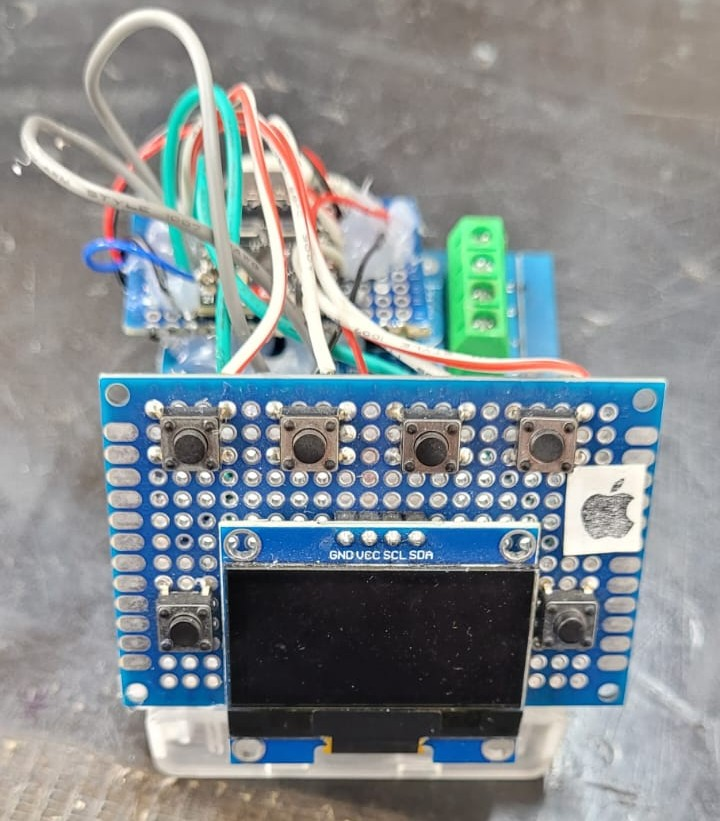

# Generator & Lector (Portable) NMEA 0183 RS422 with ESP32-C3

A portable **NMEA 0183 sentence generator and reader** built around the **ESP32-C3**, an **SH1106 OLED display**, push buttons, and a **MAX490 TTL-to-RS422 converter module**.

The device generates simulated marine instrument data, sends NMEA sentences over a serial interface, and receives NMEA sentences for monitoring. Receive (RX) and transmit (TX) serial settings can be adjusted separately using the onboard buttons.

> **Note:** This is a test and development instrument. The generated data is simulated and must not be used as a source of real navigation information.

---

<!-- Add your project photographs after uploading them to the repository.
<p align="center">
  
  
</p>
-->

## Quick Start

1. Assemble the ESP32-C3, SH1106 OLED, six push buttons, and MAX490 interface using the pinout below.
2. Install **ESP32 board support** in the Arduino IDE.
3. Install **Adafruit GFX Library** and **Adafruit SH110X** via the Library Manager.
4. Open `NMEA_Adafruit_SH110X_pin20_TX21_RX_TX_config_v3.ino` in the Arduino IDE.
5. Select the appropriate **ESP32-C3** board and serial port.
6. Compile and upload the firmware.
7. Connect the RS422 interface to a compatible NMEA 0183 device, with matching serial settings.
8. Use the front-panel buttons to generate data, inspect incoming sentences, or adjust RX/TX parameters.

> **Important:** Check the voltage specifications and pin labels of your particular MAX490 module before wiring. Do not connect RS422 differential lines directly to ESP32 GPIO pins.

---

## How the System Works

```text
                  Generator & Lector NMEA 0183
                            ESP32-C3
                               |
              +----------------+----------------+
              |                |                |
           6 buttons       SH1106 OLED       UART1 serial
              |             128 x 64           RX / TX
              |                |                |
      Mode and parameter   Live status       TTL interface
          selection        and sentences         |
                                           MAX490 module
                                                 |
                                          RS422 differential
                                                 |
                                       NMEA 0183 equipment
```

The ESP32-C3 generates ASCII NMEA 0183-style sentences with checksums in simulator mode. It transmits them through **GPIO21 (TX)**. In reader mode, it receives serial data on **GPIO20 (RX)** and shows the latest received sentence on the OLED. A separate TX configuration screen changes the format used by the generator.

**Hardware note:** RX and TX settings are stored independently in firmware variables, but the current implementation applies them **alternately to the same UART1 controller**. It does not provide two simultaneously active serial formats.

---

## Features

- Portable NMEA 0183 generator and reader
- ESP32-C3 microcontroller
- TTL/RS422 interface using a MAX490 converter board
- SH1106 128×64 I2C OLED with live status information
- Six push-button interface
- Simulated water temperature, speed, GPS-related, wind-related, heading-related, and depth-related sentences
- NMEA checksum generation
- Configurable RX and TX serial parameters
- Supported baud rates: **1200, 4800, 9600, 19200, 38400, 57600, 115200**
- Data bits: **7 or 8**
- Parity: **None (N), Even (E), Odd (O)**
- Stop bits: **1 or 2**
- Portable-power options using three AA batteries or a 3.7 V LiPo battery, with suitable power regulation

---

## Hardware

| Component | Quantity | Purpose |
|---|---:|---|
| ESP32-C3 development board | 1 | Main controller and UART |
| MAX490 TTL-to-RS422 converter module | 1 | Electrical interface to RS422/NMEA equipment |
| SH1106 128×64 I2C OLED display | 1 | On-device user interface |
| Momentary push buttons | 6 | Mode selection and parameter adjustment |
| Wiring, connectors, PCB or prototyping board | As required | Assembly |
| Suitable regulated power supply | 1 | Power for ESP32-C3 and peripherals |

### Optional Portable Power

| Optional component | Quantity | Notes |
|---|---:|---|
| 3×AA battery holder | 1 | Nominally 4.5 V with alkaline AA cells; use a regulator compatible with the board and modules |
| 3.7 V LiPo battery | 1 | Single-cell LiPo; voltage varies approximately from 4.2 V (full) to its discharge cutoff |
| LiPo charger/protection circuit | 1 | Required for safe charging and battery protection where not built into the pack |
| DC-DC regulator or suitable power-management circuit | As required | Provides the correct regulated input for the selected board/modules |
| Power switch | 1 | Optional on/off control |
| Project enclosure | 1 | Optional handheld case |

> **Power safety:** Do **not** connect a 3.7 V LiPo cell directly to the ESP32-C3 **3V3** pin; its voltage can reach 4.2 V. Do **not** assume that three AA batteries are safe to connect to an unspecified board power pin. Select a compatible regulator and follow the requirements of the ESP32-C3 development board, OLED, and MAX490 module. Never charge primary (non-rechargeable) AA cells.

---

## Wiring Overview

The following GPIO assignments are taken from the current `v3` firmware.

### SH1106 OLED → ESP32-C3

| OLED signal | ESP32-C3 |
|---|---|
| SDA | GPIO8 |
| SCL | GPIO9 |
| I2C address | `0x3C` |
| VCC / GND | Use the display module's specified supply / common GND |

### Push Buttons → ESP32-C3

| Button | GPIO | Simulator function | RX/TX configuration function |
|---|---:|---|---|
| TEMP | GPIO3 | Water temperature | Select stop bits |
| VEL | GPIO4 | Speed / wind variants | Select parity |
| GPS | GPIO5 | GPS-related variants | Select data bits |
| PROF | GPIO6 | Depth variants | Select baud rate |
| UP | GPIO7 | Increase simulated value | Increase/change selected setting |
| DOWN | GPIO10 | Decrease simulated value | Decrease/change selected setting |

Connect the buttons between their assigned GPIO and **GND**. The firmware enables internal `INPUT_PULLUP`; a pressed button reads **LOW**.

### ESP32-C3 UART → MAX490 Module

| ESP32-C3 | Signal | MAX490 module side |
|---|---|---|
| GPIO21 | UART TX | TTL data input (`DI` or module `TX` input, as labeled) |
| GPIO20 | UART RX | TTL data output (`RO` or module `RX` output, as labeled) |
| GND | Common ground | Module GND |
| Regulated supply | Module power | Module VCC according to its specifications |

On the RS422 side, connect the module's appropriate differential **TX pair** and/or **RX pair** to compatible NMEA 0183 equipment according to **the exact module datasheet**. Terminal labels (`A/B`, `Y/Z`, `TX+/TX−`, `RX+/RX−`) vary by manufacturer, and `A/B` polarity naming is not consistent across all products.

> **Compatibility warning:** The **MAX490 IC is typically a 5 V transceiver**, while the ESP32-C3 has **3.3 V GPIO**. Some converter boards include additional circuitry; others do not. Verify TTL-side voltage compatibility or use appropriate level shifting before connecting `RO` to GPIO20. This README does not assume the module is directly 3.3 V compatible.

---

## Operating Modes

### 1. NMEA Generator (Simulator)

The default startup mode. Use the four mode buttons to select a simulated instrument/data category. The **UP** and **DOWN** buttons change the simulated numeric value. The device displays the selected data on the OLED and sends generated NMEA sentences through GPIO21.

The current firmware contains the following sentence identifiers:

| Selection | Generated identifier(s) |
|---|---|
| TEMP | `WIMTW` |
| VEL | `VWVHW`, `WIMWD`, `WIMWV` |
| GPS | `GPGLL`, `GPHDM`, `GPHTD` |
| PROF | `SDDBK`, `SDDBT`, `SDDBS` |

Repeated presses of **VEL**, **GPS**, or **PROF** cycle through their variants.

> **Protocol limitation:** These are **simulated NMEA-style sentences** as implemented by the firmware; not every field currently matches the complete formal NMEA 0183 definition for its sentence type. For example, GPS-related values are generated from an adjustable test variable, not a GNSS receiver. Validate formats before using them for equipment acceptance testing.

### 2. NMEA Reader (RX)

**Hold `TEMP + PROF` for approximately 1 second** to enter or exit the reader.

- Receives serial characters through **GPIO20**.
- Displays the latest complete received line on the OLED (truncated to fit the screen).
- Offers live configuration of reception baud rate, data bits, parity, and stop bits.
- Echoes received characters to the debug serial output.

### 3. NMEA Output Configuration (TX)

**Hold `GPS + VEL` for approximately 1 second** to enter or exit the TX setup screen.

- Adjusts the serial format used for transmission on **GPIO21**.
- Uses exactly the same parameter buttons as the reader menu.
- Temporarily suspends normal sentence generation while this menu is displayed.
- Resumes simulator operation when you exit.

---

## Button Controls

| Action | Function |
|---|---|
| `TEMP + PROF` (hold 1 s) | Toggle NMEA Reader (RX) |
| `GPS + VEL` (hold 1 s) | Toggle NMEA TX Configuration |
| `PROF` in a configuration screen | Select baud rate |
| `GPS` in a configuration screen | Select data bits |
| `VEL` in a configuration screen | Select parity |
| `TEMP` in a configuration screen | Select stop bits |
| `UP` / `DOWN` in a configuration screen | Modify the selected parameter |

### Serial Parameter Options

| Parameter | Available values |
|---|---|
| Baud rate | `1200`, `4800`, `9600`, `19200`, `38400`, `57600`, `115200` |
| Data bits | `7`, `8` |
| Parity | `N` (none), `E` (even), `O` (odd) |
| Stop bits | `1`, `2` |

The default RX and TX settings in the firmware are **4800 8N1**.

```text
4800 8N1
│    ││└── 1 stop bit
│    │└─── N = no parity
│    └──── 8 data bits
└───────── 4800 baud
```

A UART stop bit is a **logic-high (1)** interval. The `1` or `2` setting indicates the **number of stop-bit intervals**, not a selectable high/low value.

> **Configuration persistence:** RX and TX parameters are independent **RAM variables** in the current firmware. They revert to their defaults after reset/power cycle; EEPROM/NVS persistence is not implemented.

---

## OLED Display

The SH1106 OLED provides a compact interface for simulated measurements, selected mode, and NMEA serial configuration.

Example RX settings:

```text
RX NMEA >BAUD
4800  8N1
UP/DN cambia
Dato:
$GPGLL,...
```

Example TX settings:

```text
TX NMEA >BAUD
4800  8N1
UP/DN cambia
GPS+VEL: salir
Salida GPIO21
```

The OLED is initialized through **I2C on GPIO8/GPIO9** with address `0x3C`.

---

## NMEA 0183 Data Format

NMEA 0183 sentences are generally transmitted as ASCII text with a sentence delimiter, comma-separated fields, an optional checksum introduced by `*`, and a line terminator.

```text
$WIMTW,23.5,C*hh<CR><LF>
```

Here, `hh` represents two hexadecimal checksum characters. The checksum is the **XOR of the bytes between `$` and `*`**, excluding both delimiters.

**Important distinction:** `4800 8N1`, `9600 7E1`, etc. define the **UART character framing**, not the NMEA sentence content or checksum algorithm. Both connected endpoints must agree on a compatible serial configuration for reliable communication.

---

## Software Requirements

- **Arduino IDE** with Espressif **ESP32** board package
- **Adafruit GFX Library**
- **Adafruit SH110X**
- **Wire** (included with Arduino ESP32)

Main firmware includes:

```cpp
#include <Wire.h>
#include <Adafruit_GFX.h>
#include <Adafruit_SH110X.h>
```

Install the two Adafruit libraries through **Arduino IDE → Library Manager**.

---

## Installation

1. Download or clone the repository containing the firmware.
2. Open `NMEA_Adafruit_SH110X_pin20_TX21_RX_TX_config_v3.ino` with the Arduino IDE.
3. Install the ESP32 board package and the two Adafruit libraries.
4. Select an ESP32-C3 board and the correct upload port.
5. Connect all hardware according to the wiring tables, checking voltage compatibility first.
6. Compile and flash the firmware.
7. Power the system through a suitable regulated supply.
8. Verify the OLED starts and test TX/RX using a compatible serial interface or NMEA device.

The firmware uses `Serial.begin(4800)` for its debug serial output. This debug baud setting is distinct from the configurable NMEA UART.

---

## Power Supply and Portable Enclosure

### Option A — Three AA Batteries

A 3×AA holder provides a nominal **4.5 V with alkaline cells**; the actual voltage changes with battery chemistry and state of charge. Use a suitable voltage-regulation path compatible with the selected ESP32-C3 board and peripheral modules. Do not attach the battery holder directly to the 3.3 V rail.

### Option B — Single-Cell 3.7 V LiPo

A nominal 3.7 V LiPo reaches approximately **4.2 V at full charge**. Use a single-cell charging/protection solution and a regulator sized for the entire load. A protected battery pack is recommended; never directly connect a raw cell to the 3.3 V rail.

### Optional Case

A handheld 3D-printed or other nonconductive case can accommodate the ESP32-C3, MAX490 converter, OLED, six push buttons, a power switch, and the chosen battery solution. Provide adequate wiring clearance, insulation, and external RS422 connections. Keep the battery accessible for safe replacement or charging.

---

## Limitations

- **Not navigation certified.** Generated values are for simulation, testing and development.
- The present firmware applies the selected RX or TX settings to **one shared UART1 peripheral**, rather than providing simultaneous independent UART configurations.
- The RX screen shows the latest received line but **does not perform full validation/parsing of every incoming NMEA sentence**.
- RX/TX settings are **not persistent** across resets.
- The generated sentence fields should be checked against NMEA 0183 requirements before interoperability or conformance testing.
- RS422 electrical compatibility depends on the particular MAX490 module, supply voltage, wiring and the connected equipment.

---

## Contributing

Bug reports, hardware tests, documentation improvements, and pull requests are welcome. Useful contributions include NMEA sentence validation, persistent UART settings, additional instrument sentences, and verified MAX490 module wiring examples.

---

## License

MIT

---

## Disclaimer

This project is intended for **education, prototyping, laboratory testing, and marine-electronics development**. Verify all wiring, voltage levels, UART settings, and generated data before connecting it to operational marine equipment. It must not be relied on for vessel navigation or safety-critical decisions.

---

## Support the Project

If the project is useful, consider starring the repository and sharing test results, improvements, or compatible hardware configurations.

