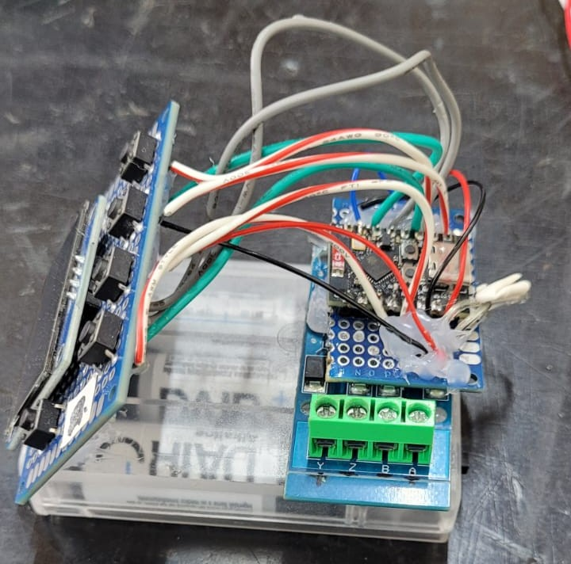
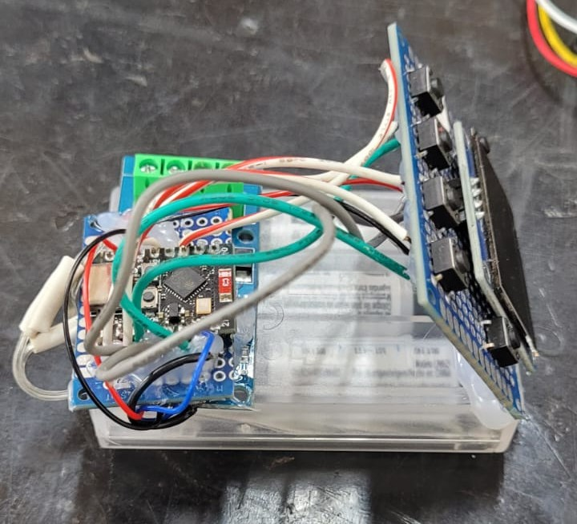

# Generador y lector portátil NMEA 0183 RS422 con ESP32-C3

Un **generador y lector portátil de sentencias NMEA 0183** basado en el **ESP32-C3**, una **pantalla OLED SH1106**, pulsadores y un **módulo conversor TTL a RS422 MAX490**.

El dispositivo genera datos simulados de instrumentos marinos, transmite sentencias NMEA mediante una interfaz serie y recibe sentencias NMEA para su supervisión. Los parámetros serie de recepción (RX) y transmisión (TX) pueden ajustarse por separado mediante los botones integrados.

> **Nota:** Este es un instrumento de prueba y desarrollo. Los datos generados son simulados y no deben utilizarse como fuente de información real para la navegación.

---

<p align="center">
  
  
  
</p>

## Inicio rápido

1. Monta el ESP32-C3, la pantalla OLED SH1106, los seis pulsadores y la interfaz MAX490 siguiendo la asignación de pines indicada más adelante.
2. Instala la **compatibilidad con placas ESP32** en Arduino IDE.
3. Instala **Adafruit GFX Library** y **Adafruit SH110X** desde el gestor de bibliotecas.
4. Abre `Firmware_V0.1.ino` en Arduino IDE.
5. Selecciona la placa **ESP32-C3** correspondiente y el puerto serie.
6. Compila y carga el firmware.
7. Conecta la interfaz RS422 a un equipo NMEA 0183 compatible y configura los mismos parámetros serie en ambos extremos.
8. Utiliza los botones del panel frontal para generar datos, inspeccionar las sentencias recibidas o ajustar los parámetros RX/TX.

> **Importante:** Comprueba las especificaciones de tensión y la identificación de los pines de tu módulo MAX490 antes de conectarlo. No conectes las líneas diferenciales RS422 directamente a los GPIO del ESP32.

---

## Funcionamiento del sistema

<p align="center">
  
</p>

En modo simulador, el ESP32-C3 genera sentencias ASCII con formato NMEA 0183 y suma de comprobación (*checksum*). Las transmite por **GPIO21 (TX)**. En modo lector, recibe datos serie por **GPIO20 (RX)** y muestra en la OLED la última sentencia recibida. Una pantalla independiente de configuración TX permite cambiar el formato serie utilizado por el generador.

**Nota de hardware:** Los parámetros RX y TX se almacenan de forma independiente en variables del firmware, pero la implementación actual los aplica **alternativamente al mismo controlador UART1**. No permite utilizar simultáneamente dos formatos serie diferentes.

---

## Características

- Generador y lector portátil NMEA 0183.
- Microcontrolador ESP32-C3.
- Interfaz TTL/RS422 mediante un módulo conversor MAX490.
- Pantalla OLED SH1106 I2C de 128 × 64 píxeles con información de estado en tiempo real.
- Interfaz de seis pulsadores.
- Simulación de sentencias relacionadas con temperatura del agua, velocidad, GPS, viento, rumbo y profundidad.
- Generación del checksum NMEA.
- Configuración de parámetros serie RX y TX.
- Velocidades admitidas: **1200, 4800, 9600, 19200, 38400, 57600 y 115200 baudios**.
- Bits de datos: **7 u 8**.
- Paridad: **ninguna (N), par (E) o impar (O)**.
- Bits de parada: **1 o 2**.
- Opciones de alimentación portátil mediante tres pilas AA o una batería LiPo de 3,7 V, con regulación de tensión adecuada.

---

## Hardware

| Componente | Cantidad | Función |
|---|---:|---|
| Placa de desarrollo ESP32-C3 | 1 | Controlador principal y UART |
| Módulo conversor TTL a RS422 MAX490 | 1 | Interfaz eléctrica con equipos RS422/NMEA |
| Pantalla OLED SH1106 I2C de 128 × 64 | 1 | Interfaz de usuario |
| Pulsadores momentáneos | 6 | Selección de modos y ajuste de parámetros |
| Cables, conectores, PCB o placa de prototipado | Según necesidad | Montaje |
| Fuente de alimentación regulada adecuada | 1 | Alimentación del ESP32-C3 y sus periféricos |

### Alimentación portátil opcional

| Componente opcional | Cantidad | Observaciones |
|---|---:|---|
| Portapilas para 3 pilas AA | 1 | Aproximadamente 4,5 V nominales con pilas alcalinas; utiliza un regulador compatible con la placa y los módulos |
| Batería LiPo de 3,7 V | 1 | LiPo de una celda; su tensión varía aproximadamente desde 4,2 V (carga completa) hasta el límite de descarga |
| Circuito de carga y protección LiPo | 1 | Necesario para una carga segura y la protección de la batería, si no está integrado en el paquete |
| Regulador DC-DC o circuito de gestión de energía adecuado | Según necesidad | Proporciona la tensión regulada correcta para la placa y los módulos elegidos |
| Interruptor de alimentación | 1 | Control de encendido y apagado opcional |
| Carcasa | 1 | Caja portátil opcional |

> **Seguridad de alimentación:** **No** conectes directamente una celda LiPo de 3,7 V al pin **3V3** del ESP32-C3: puede alcanzar 4,2 V. **No** supongas que tres pilas AA pueden conectarse con seguridad a cualquier pin de alimentación de la placa. Selecciona un regulador compatible y sigue las especificaciones de la placa ESP32-C3, la pantalla OLED y el módulo MAX490. Nunca intentes recargar pilas AA primarias (no recargables).

---

## Resumen de conexiones

Las siguientes asignaciones GPIO corresponden al firmware `v3` actual.

### Pantalla OLED SH1106 → ESP32-C3

| Señal OLED | ESP32-C3 |
|---|---|
| SDA | GPIO8 |
| SCL | GPIO9 |
| Dirección I2C | `0x3C` |
| VCC / GND | Utilizar la alimentación especificada para el módulo y masa común |

### Pulsadores → ESP32-C3

| Botón | GPIO | Función en simulador | Función en configuración RX/TX |
|---|---:|---|---|
| TEMP | GPIO3 | Temperatura del agua | Seleccionar bits de parada |
| VEL | GPIO4 | Variantes de velocidad/viento | Seleccionar paridad |
| GPS | GPIO5 | Variantes relacionadas con GPS | Seleccionar bits de datos |
| PROF | GPIO6 | Variantes de profundidad | Seleccionar velocidad en baudios |
| UP | GPIO7 | Aumentar valor simulado | Aumentar/cambiar el ajuste seleccionado |
| DOWN | GPIO10 | Disminuir valor simulado | Disminuir/cambiar el ajuste seleccionado |

Conecta cada pulsador entre su GPIO asignado y **GND**. El firmware activa `INPUT_PULLUP`; al presionar un botón, su entrada se lee como **LOW**.

### UART del ESP32-C3 → Módulo MAX490

| ESP32-C3 | Señal | Lado del módulo MAX490 |
|---|---|---|
| GPIO21 | UART TX | Entrada de datos TTL (`DI` o entrada `TX`, según el etiquetado) |
| GPIO20 | UART RX | Salida de datos TTL (`RO` o salida `RX`, según el etiquetado) |
| GND | Masa común | GND del módulo |
| Alimentación regulada | Alimentación del módulo | VCC según sus especificaciones |

En el lado RS422, conecta el **par diferencial TX** y/o el **par diferencial RX** adecuado del módulo a un equipo NMEA 0183 compatible, siguiendo **la hoja de datos exacta del módulo**. Los nombres de los terminales (`A/B`, `Y/Z`, `TX+/TX−`, `RX+/RX−`) varían entre fabricantes, y la nomenclatura de polaridad `A/B` no es uniforme entre todos los productos.

> **Advertencia de compatibilidad:** El **circuito integrado MAX490 suele ser un transceptor de 5 V**, mientras que los **GPIO del ESP32-C3 funcionan a 3,3 V**. Algunas placas conversoras incorporan circuitería adicional y otras no. Comprueba la compatibilidad de tensión del lado TTL o utiliza adaptación de nivel antes de conectar `RO` a GPIO20. Este README no presupone que el módulo sea directamente compatible con 3,3 V.

---

## Modos de funcionamiento

### 1. Generador NMEA (simulador)

Es el modo predeterminado al iniciar. Utiliza los cuatro botones de modo para seleccionar la categoría de instrumento o datos simulados. Los botones **UP** y **DOWN** modifican el valor numérico simulado. El equipo muestra el dato seleccionado en la OLED y transmite las sentencias NMEA generadas por GPIO21.

<p align="center">
  
</p>

El firmware actual contiene los siguientes identificadores de sentencia:

| Selección | Identificador(es) generado(s) |
|---|---|
| TEMP | `WIMTW` |
| VEL | `VWVHW`, `WIMWD`, `WIMWV` |
| GPS | `GPGLL`, `GPHDM`, `GPHTD` |
| PROF | `SDDBK`, `SDDBT`, `SDDBS` |

Las pulsaciones sucesivas de **VEL**, **GPS** o **PROF** permiten recorrer sus variantes.

> **Limitación del protocolo:** Son **sentencias simuladas de estilo NMEA**, tal como están implementadas en el firmware; no todos los campos coinciden actualmente con la definición formal completa de NMEA 0183 para cada tipo de sentencia. Por ejemplo, los valores relacionados con GPS proceden de una variable de prueba ajustable, no de un receptor GNSS. Valida los formatos antes de utilizarlos en pruebas de aceptación de equipos.

### 2. Lector NMEA (RX)

**Mantén presionados `TEMP + PROF` durante aproximadamente 1 segundo** para entrar o salir del lector.

- Recibe caracteres serie mediante **GPIO20**.
- Muestra la última línea completa recibida en la OLED (recortada para ajustarse a la pantalla).
- Permite configurar en tiempo real la velocidad en baudios, los bits de datos, la paridad y los bits de parada de la recepción.
- Reenvía los caracteres recibidos al puerto serie de depuración.

<p align="center">
  
</p>

### 3. Configuración de salida NMEA (TX)

**Mantén presionados `GPS + VEL` durante aproximadamente 1 segundo** para entrar o salir de la pantalla de configuración TX.

- Ajusta el formato serie utilizado para transmitir por **GPIO21**.
- Utiliza exactamente los mismos botones de parámetros que el menú lector.
- Suspende temporalmente la generación normal de sentencias mientras se muestra este menú.
- Reanuda el funcionamiento del simulador al salir.

<p align="center">
  
</p>

---

## Controles de los botones

| Acción | Función |
|---|---|
| `TEMP + PROF` (mantener 1 s) | Activar/desactivar el lector NMEA (RX) |
| `GPS + VEL` (mantener 1 s) | Activar/desactivar la configuración NMEA TX |
| `PROF` en una pantalla de configuración | Seleccionar velocidad en baudios |
| `GPS` en una pantalla de configuración | Seleccionar bits de datos |
| `VEL` en una pantalla de configuración | Seleccionar paridad |
| `TEMP` en una pantalla de configuración | Seleccionar bits de parada |
| `UP` / `DOWN` en una pantalla de configuración | Modificar el parámetro seleccionado |

### Opciones de los parámetros serie

| Parámetro | Valores disponibles |
|---|---|
| Velocidad en baudios | `1200`, `4800`, `9600`, `19200`, `38400`, `57600`, `115200` |
| Bits de datos | `7`, `8` |
| Paridad | `N` (ninguna), `E` (par), `O` (impar) |
| Bits de parada | `1`, `2` |

La configuración predeterminada de RX y TX en el firmware es **4800 8N1**.

<p align="center">
  
</p>

Un bit de parada UART es un intervalo de **nivel lógico alto (1)**. El ajuste `1` o `2` indica el **número de intervalos de bit de parada**, no un valor alto/bajo seleccionable.

> **Persistencia de configuración:** Los parámetros RX y TX son variables independientes en **RAM** en el firmware actual. Vuelven a sus valores predeterminados al reiniciar o apagar el dispositivo; no está implementado su almacenamiento persistente en EEPROM/NVS.

---

## Pantalla OLED

La pantalla OLED SH1106 proporciona una interfaz compacta para las mediciones simuladas, el modo seleccionado y la configuración serie NMEA.

Ejemplo de configuración RX:

```text
RX NMEA >BAUD
4800  8N1
UP/DN: adjust
Data:
$GPGLL,...
```

Ejemplo de configuración TX:

```text
TX NMEA >BAUD
4800  8N1
UP/DN: adjust
GPS+VEL: exit
```

La pantalla OLED se inicializa mediante **I2C en GPIO8/GPIO9**, con dirección `0x3C`.

---

## Formato de datos NMEA 0183

Las sentencias NMEA 0183 se transmiten generalmente como texto ASCII con un delimitador de inicio, campos separados por comas, una suma de comprobación opcional introducida mediante `*` y un terminador de línea.

```text
$WIMTW,23.5,C*hh<CR><LF>
```

Aquí, `hh` representa dos caracteres hexadecimales de checksum. El checksum se calcula mediante una operación **XOR de los bytes comprendidos entre `$` y `*`**, sin incluir dichos delimitadores.

**Distinción importante:** `4800 8N1`, `9600 7E1`, etc., definen el **encuadre de los caracteres UART**, no el contenido de la sentencia NMEA ni el algoritmo de checksum. Ambos extremos de la conexión deben utilizar una configuración serie compatible para garantizar una comunicación fiable.

---

## Requisitos de software

- **Arduino IDE** con el paquete de placas **ESP32** de Espressif.
- **Adafruit GFX Library**.
- **Adafruit SH110X**.
- **Wire** (incluida con Arduino ESP32).

El firmware principal incluye:

```cpp
#include <Wire.h>
#include <Adafruit_GFX.h>
#include <Adafruit_SH110X.h>
```

Instala las dos bibliotecas de Adafruit desde **Arduino IDE → Gestor de bibliotecas**.

---

## Instalación

1. Descarga o clona el repositorio que contiene el firmware.
2. Abre `Firmware_V01.ino` con Arduino IDE.
3. Instala el paquete de placas ESP32 y las dos bibliotecas de Adafruit.
4. Selecciona una placa ESP32-C3 y el puerto de carga correcto.
5. Conecta todo el hardware según las tablas de conexiones, comprobando antes la compatibilidad de tensiones.
6. Compila y carga el firmware.
7. Alimenta el sistema mediante una fuente regulada adecuada.
8. Comprueba que se inicia la OLED y prueba TX/RX con una interfaz serie o dispositivo NMEA compatible.

El firmware utiliza `Serial.begin(4800)` para el puerto serie de depuración. Esta velocidad de depuración es distinta de la UART NMEA configurable.

---

## Alimentación y carcasa portátil

### Opción A — Tres pilas AA

Un portapilas de 3 × AA proporciona aproximadamente **4,5 V nominales con pilas alcalinas**; la tensión real varía según la química y el estado de carga de las pilas. Utiliza una regulación de tensión adecuada y compatible con la placa ESP32-C3 y los módulos periféricos elegidos. No conectes el portapilas directamente a la línea de 3,3 V.

### Opción B — Batería LiPo de una celda de 3,7 V

Una LiPo de 3,7 V nominales alcanza aproximadamente **4,2 V cuando está completamente cargada**. Utiliza una solución de carga y protección para una celda y un regulador dimensionado para todo el consumo. Se recomienda una batería con protección integrada; nunca conectes una celda sin regulación directamente a la línea de 3,3 V.

### Carcasa opcional

Una carcasa portátil impresa en 3D o de otro material no conductor puede alojar el ESP32-C3, el conversor MAX490, la OLED, los seis pulsadores, un interruptor y la solución de batería elegida. Deja suficiente espacio para cableado, aislamiento y conexiones RS422 externas. Mantén la batería accesible para sustituirla o cargarla de forma segura.

---

## Limitaciones

- **No está certificado para navegación.** Los valores generados se destinan a simulación, pruebas y desarrollo.
- El firmware actual aplica los ajustes RX o TX seleccionados a **un único periférico UART1 compartido**, en lugar de ofrecer configuraciones UART independientes y simultáneas.
- La pantalla RX muestra la última línea recibida, pero **no realiza una validación ni un análisis completo de todas las sentencias NMEA entrantes**.
- Los parámetros RX/TX **no se conservan** después de reiniciar el dispositivo.
- Los campos de las sentencias generadas deben contrastarse con los requisitos NMEA 0183 antes de realizar pruebas de interoperabilidad o conformidad.
- La compatibilidad eléctrica RS422 depende del módulo MAX490 concreto, la tensión de alimentación, el cableado y el equipo conectado.

---

## Contribuciones

Se agradecen informes de errores, pruebas de hardware, mejoras de documentación y solicitudes de incorporación de cambios (*pull requests*). Entre las contribuciones útiles se incluyen la validación de sentencias NMEA, la configuración UART persistente, nuevas sentencias de instrumentos y ejemplos verificados de conexión de módulos MAX490.

---

## Licencia

MIT

---

## Aviso de responsabilidad

Este proyecto está destinado a **educación, creación de prototipos, pruebas de laboratorio y desarrollo de electrónica marina**. Verifica todas las conexiones, los niveles de tensión, la configuración UART y los datos generados antes de conectarlo a equipos marinos operativos. No debe utilizarse para navegar ni para tomar decisiones críticas para la seguridad.

---

## Apoya el proyecto

Si el proyecto te resulta útil, considera marcar el repositorio con una estrella y compartir resultados de pruebas, mejoras o configuraciones de hardware compatibles.
